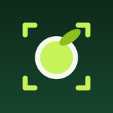
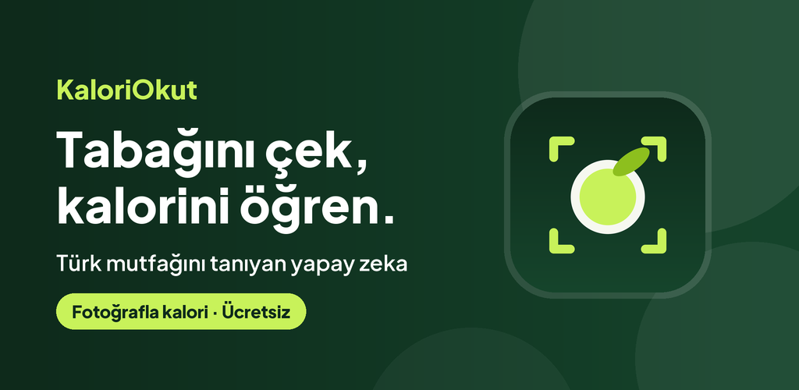
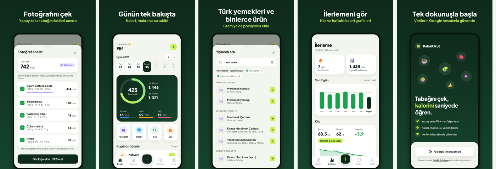
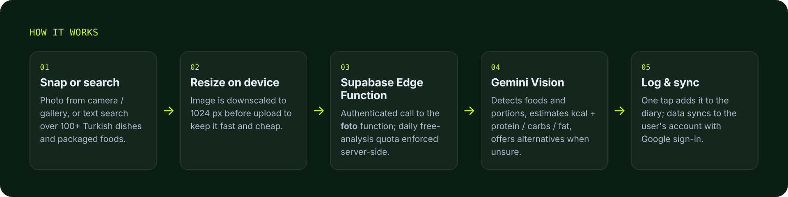

  

<h1 align="center">KaloriOkut</h1>

<b>Photograph your plate to see its calories.</b> An AI calorie tracker that understands Turkish cuisine.

  
  
  
  
  

> This repository is a **project showcase**. The source code is private.

## What it does

You take a photo of your meal. KaloriOkut recognises each food on the plate, estimates the portion and returns **calories, protein, carbs and fat** in seconds. It is built around Turkish food: menemen, lahmacun, mercimek çorbası, baklava and many more.

| | Feature |
|---|---|
| 📸 | **Photo to calories.** Detects each food and its portion. When it isn't sure, it offers alternatives such as *ayran or yoğurt?* |
| 🔍 | **Fast search.** 100+ Turkish dishes are built into the app, and thousands of packaged products come from FatSecret and Open Food Facts. You can log by gram or by portion. |
| 🎯 | **Personal targets.** Daily calorie and macro goals are set from age, height, weight, activity level and your goal (lose, maintain or gain). |
| 📊 | **Progress tracking.** Separate logs for breakfast, lunch, dinner and snacks, plus water tracking, a weight chart, a weekly calorie chart and a 🔥 logging streak. |
| 💊 | **Vitamin & mineral guide.** Suggestions for nutrients you may be missing, based on what you ate. |
| ☁️ | **Your data stays yours.** Sign in with Google, sync to the cloud, no ads and no data selling. You can delete your data or your whole account at any time. |

## How it works

- **App:** React Native with Expo. JS-only updates ship over the air with EAS Update, and native builds use EAS Build.
- **Backend:** Supabase handles Google sign-in and the Postgres database. An Edge Function (`foto`) calls Gemini Vision and enforces a daily free-analysis quota.
- **Data sources:** an on-device table of Turkish foods, the FatSecret API and Open Food Facts.
- **Privacy:** photos are resized to 1024 px on the device before upload. A separate page lets users delete their account and data.

## Roadmap

- [x] Photo analysis, search, targets, progress and cloud sync
- [x] Account and data deletion flow
- [ ] Barcode scanning (expo-camera)
- [ ] Google Play closed test, then public release

---

Nutrition values are estimates and are not medical advice. Built by <a href="https://github.com/mtaiea">Mustafa Talha Arı</a>.
